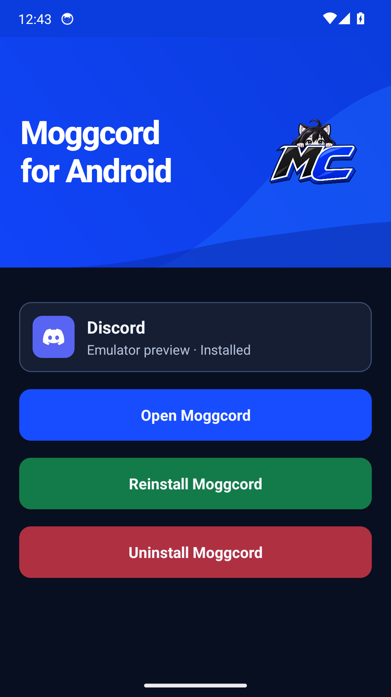

  
  <h1>Moggcord Mobile</h1>
  
Plugins, themes and a dedicated Moggcord settings panel for Discord on Android, iPhone and iPad.

  

    <a href="https://moggcord.cc/#download-panel-android"><strong>Android</strong></a> ·
    <a href="https://moggcord.cc/#download-panel-ios"><strong>iOS and iPadOS</strong></a> ·
    <a href="https://github.com/moggcord/moggcord-mobile/releases">Releases</a> ·
    <a href="https://github.com/moggcord/moggcord">Desktop</a> ·
    <a href="https://github.com/sponsors/caedesdev">Sponsor</a>
  

## Install Moggcord Mobile

| Platform | What you need | Setup |
| --- | --- | --- |
| **Android 9+** | The Moggcord launcher APK and a compatible Discord installation | [Download the launcher](https://moggcord.cc/#download-panel-android) · [Android guide](android/README.md) |
| **iOS and iPadOS 16+** | An arm64 build and a prepared IPA signed with AltStore Classic or Sideloadly | [iOS downloads](https://moggcord.cc/#download-panel-ios) · [iOS guide](ios/README.md) |

On Android, open the launcher and choose **Install in Discord**. It creates a separate Moggcord app with its own sign-in and settings. On iPhone or iPad, follow the signing steps in the iOS guide. In the installed app, open **Discord Settings → Moggcord Mobile**.

  
Android launcher preview

   
  

    
  

## What you can customize

| Feature | Where to find it |
| --- | --- |
| **Plugins** | Search the bundled mobile plugins and manage switches and per-plugin settings. Enabled plugins can add entries to supported Discord menus. |
| **Themes** | Browse mobile themes in **Community → Themes → Open Theme Library**. Apply a JSON color theme and restart Discord. Midnight, Cobalt and Dusk style the Moggcord panel. |
| **Community and favorites** | Browse community uploads and save favorites from the Community tab. |
| **Backup and profiles** | Use Settings to export your color profile, favorites and plugin switches or restore saved preferences for the account you use. |
| **Signed runtime updates** | Open **Settings → Moggcord updates** for compatible plugin and UI updates. See the [loader requirements and recovery guide](docs/in-app-updates.md). |

## Build and get help

Use Node.js 24 to test the shared payload. Use the [Android](android/README.md) or [iOS](ios/README.md) guide to build the native loader for that platform.

~~~sh
npm ci
npm test
npm run build
~~~

The shared React Native code lives in **shared/**. Both platform loaders package the built payload with the native artifact. [Development builds](https://github.com/moggcord/moggcord-mobile/actions/workflows/mobile.yml)

When reporting a problem, include your device, OS version, Discord build and Moggcord version. [Report an issue](https://github.com/moggcord/moggcord-mobile/issues) · [Community Discord](https://discord.gg/moggcord) · [Service status](https://moggcord.cc/status)

## Support Moggcord

[**Sponsor Moggcord on GitHub**](https://github.com/sponsors/caedesdev). Contributions support mobile development and compatibility work.

Moggcord Mobile is an independent project for Discord. [License](LICENSE) · [Credits and third-party licenses](NOTICE.md)
